# Draft posts (dry run)

Newest first. Nothing here has been published.

## সৌদি আরবের নিরাপত্তা শঙ্কায় বিমানের দাম্মাম ও রিয়াদ ফ্লাইট স্থগিত

✅ approved · 23 Oct 01:32 Dhaka · score 10 · flight_disruption · sources: Bangladesh Journal, Prothom Alo

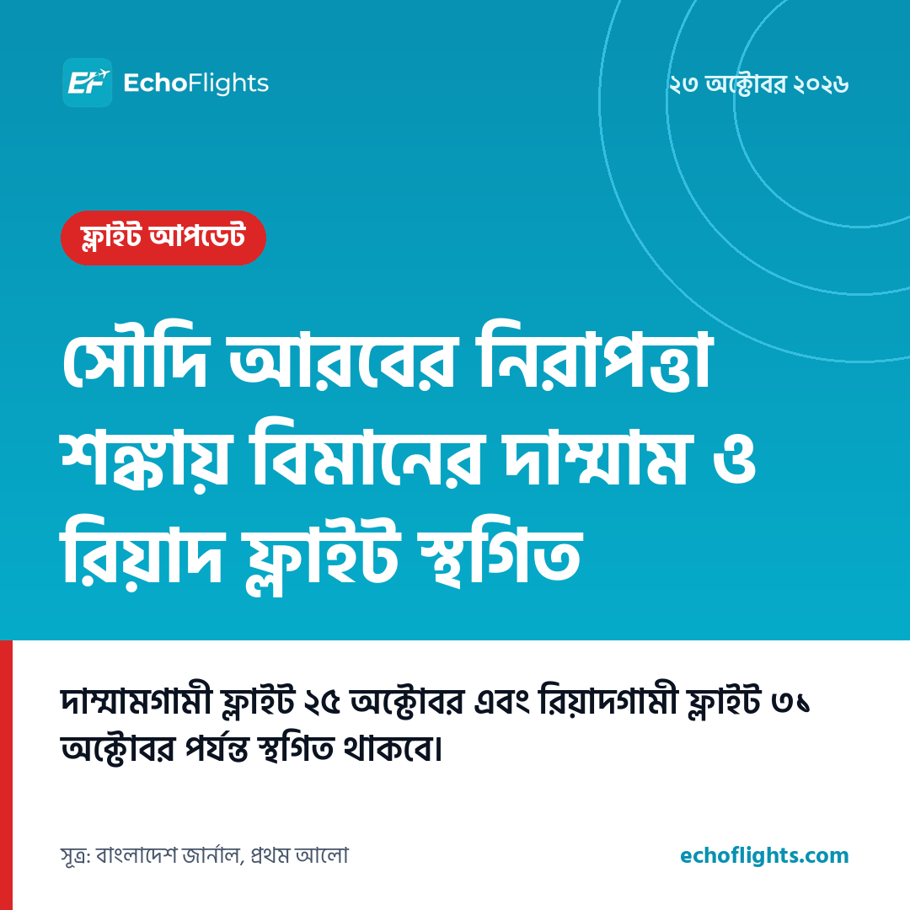

**Facebook caption**

```
সৌদি আরবে বিমানবন্দর কেন্দ্রিক হামলার কারণে দাম্মাম ও রিয়াদগামী সব ফ্লাইট আবার স্থগিত করেছে বিমান বাংলাদেশ এয়ারলাইনস।

ঘোষণা অনুযায়ী, ঢাকা থেকে দাম্মামগামী ফ্লাইট ২৫ অক্টোবর এবং রিয়াদগামী ফ্লাইট ৩১ অক্টোবর পর্যন্ত বন্ধ থাকবে। গত ২১ অক্টোবর রাতে দাম্মামের কিং ফাহাদ আন্তর্জাতিক বিমানবন্দরে হামলার ঘটনার পর যাত্রীদের নিরাপত্তার স্বার্থে এ সিদ্ধান্ত নেওয়া হয়েছে। তবে জেদ্দা ও মদিনাগামী ফ্লাইট নির্ধারিত সূচি অনুযায়ী চলাচল করবে।

আক্রান্ত যাত্রীরা আসন খালি থাকা সাপেক্ষে জেদ্দা বা মদিনা হয়ে ভ্রমণ করতে পারবেন। টিকিট ও সূচির জন্য নিকটস্থ বিমান কার্যালয়ে যোগাযোগের অনুরোধ করা হয়েছে।

সূত্র: বাংলাদেশ জার্নাল ও প্রথম আলো

#BimanBangladesh #SaudiArabia #FlightUpdate #TravelAlert #EchoFlights
```

**Blog:** [সৌদি আরবে বিমানবন্দর হামলায় বিমানের দাম্মাম ও রিয়াদ ফ্লাইট স্থগিত](2026-10-23/2a1321c2a2/blog.md) · slug `biman-suspends-dammam-riyadh-flights-saudi-arabia`

**Sources:** [বাংলাদেশ জার্নাল](https://www.bd-journal.com/bangladesh/314595/দাম্মামের-সব-ফ্লাইট-তিন-দিন-বন্ধ-রিয়াদ-রুটে-৩১-অক্টোবর-পর্যন্ত-স্থগিত) (feed summary only) · [প্রথম আলো](https://www.prothomalo.com/bangladesh/mdm4unravg)

---

## চাকরির প্রলোভনে রাশিয়ায় গিয়ে যুদ্ধে ৩ বছরে অন্তত ৫৪ বাংলাদেশির মৃত্যু

✅ approved · 22 Oct 18:06 Dhaka · score 10 · expat_alert · sources: BD24Live, Prothom Alo

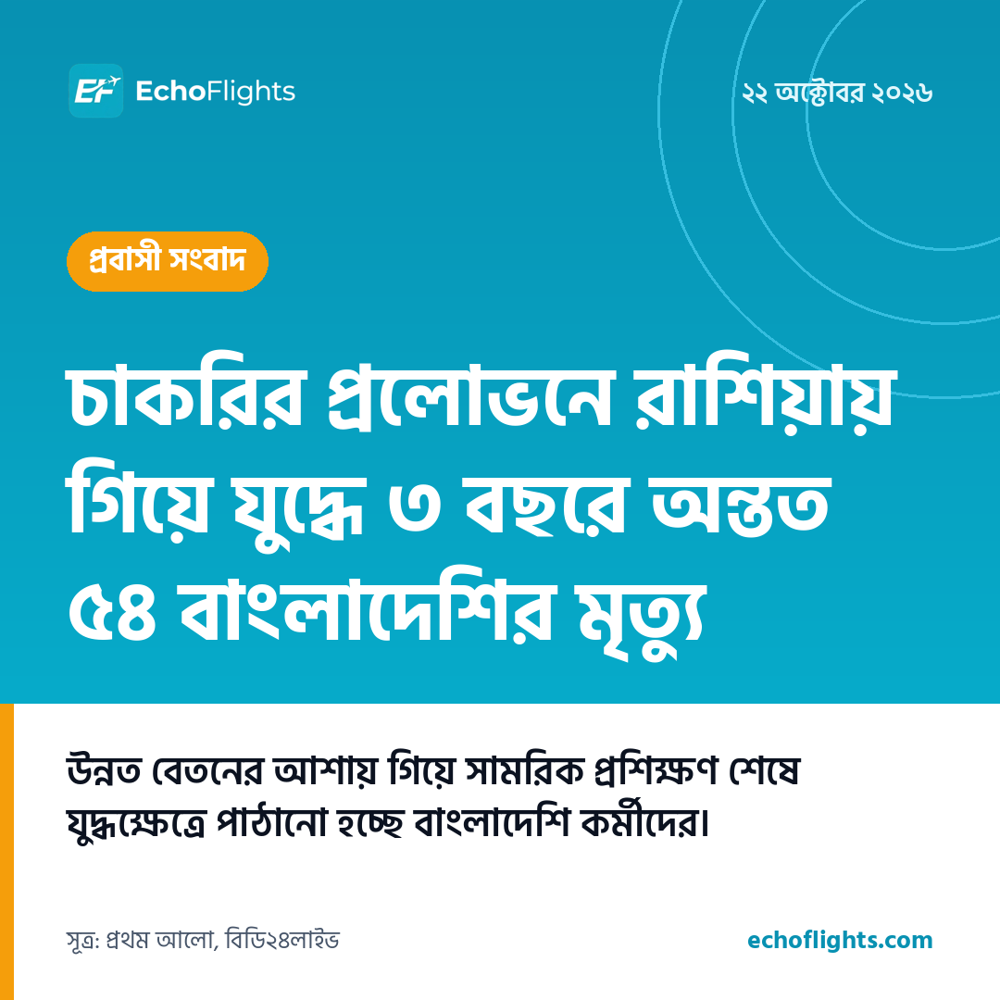

**Facebook caption**

```
উন্নত চাকরির প্রলোভনে রাশিয়ায় গিয়ে ইউক্রেন যুদ্ধে জড়িয়ে গত তিন বছরে অন্তত ৫৪ জন বাংলাদেশি কর্মীর মৃত্যুর তথ্য পাওয়া গেছে।

ভুক্তভোগীদের পরিবার ও ফেরত আসা ব্যক্তিদের বরাতে জানা যায়, বিভিন্ন এজেন্সির মাধ্যমে কাজের কথা বলে কর্মীদের রাশিয়ায় পাঠানো হয়। সেখানে সামরিক প্রশিক্ষণ শেষে তাঁদের যুদ্ধক্ষেত্রে নামানো হচ্ছে। সম্মুখসারিতে নিখোঁজদের মৃত গণ্য করা হলেও মরদেহ হস্তান্তর করছে না রুশ কর্তৃপক্ষ।

সূত্র: প্রথম আলো, বিডি টোয়েন্টিফোর লাইভ
#RussiaWar #BangladeshiWorkers #ExpatNews #BangladeshEmbassy #EchoFlights
```

**Blog:** [চাকরির প্রলোভনে রাশিয়ায় গিয়ে যুদ্ধক্ষেত্রে বাংলাদেশিরা, ৩ বছরে বহু মৃত্যুর তথ্য](2026-10-22/1c46957cfe/blog.md) · slug `bangladeshi-workers-lured-to-russia-war`

**Sources:** [প্রথম আলো](https://www.prothomalo.com/bangladesh/mkf2is07uv) · [প্রথম আলো](https://en.prothomalo.com/bangladesh/pqmoumnzr2) · [বিডি২৪লাইভ](https://www.bd24live.com/bangla/810438)

_Rewritten once after review (2 issues in first draft)._

---

## দাম্মাম বিমানবন্দরে হামলার পর পুনরায় বিমান চলাচল স্বাভাবিক

✅ approved · 22 Oct 14:06 Dhaka · score 10 · airport · sources: Bangladesh Diplomat, Gulf News

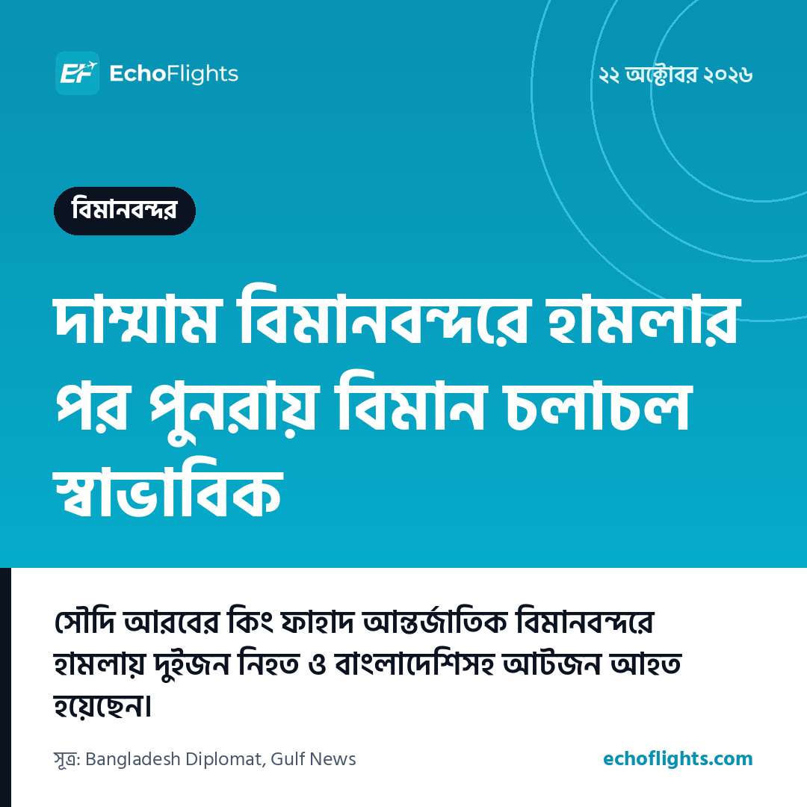

**Facebook caption**

```
সৌদি আরবের দাম্মাম শহরের কিং ফাহাদ আন্তর্জাতিক বিমানবন্দরে হামলার পর পুনরায় বিমান চলাচল স্বাভাবিক হয়েছে। সৌদি আরবের বেসামরিক বিমান চলাচল কর্তৃপক্ষ (GACA) নিশ্চিত করেছে যে বৃহস্পতিবার বিমানবন্দরটির ফ্লাইট পরিচালনা স্বাভাবিক অবস্থায় ফিরে এসেছে।

গত বুধবার সন্ধ্যায় সংঘটিত এই হামলায় দুইজন নিহত এবং বাংলাদেশিসহ অন্তত আটজন আহত হন। আহতদের মধ্যে একজন সৌদি নাগরিক এবং বাংলাদেশ, ভারত, ইয়েমেন ও নেপালের সাতজন প্রবাসী রয়েছেন। GACA সূত্রে জানা গেছে, নিহতদের মধ্যে একজন সৌদি নাগরিক এবং একজন ভারতীয় নাগরিক। নিরাপত্তা সংস্থাগুলো ক্ষয়ক্ষতি নিরূপণ ও যাত্রীদের সুরক্ষা নিশ্চিতে কাজ করছে।

সূত্র: বাংলাদেশ ডিপ্লোম্যাট ও গালফ নিউজ

#SaudiArabia #DammamAirport #GACA #BangladeshiExpat #EchoFlights
```

**Blog:** [সৌদি আরবের দাম্মাম বিমানবন্দরে হামলার পর বিমান চলাচল শুরু, আহতদের মধ্যে বাংলাদেশি](2026-10-22/167e3a2c35/blog.md) · slug `saudi-arabia-dammam-airport-attack-resumes-operations`

**Sources:** [Bangladesh Diplomat](https://bangladeshdiplomat.com/43895/latest/raw38409/) · [Gulf News](https://gulfnews.com/world/gulf/saudi/saudi-arabias-dammam-airport-resumes-operations-after-attack-kills-two-injures-eight-1.500719434)

_Rewritten once after review (3 issues in first draft)._

---

## সৌদি আরবে হামলায় নিহত ওমরাহযাত্রী নাসরুল্লাহর পরিবারের পাশে দাঁড়ালেন ধর্মমন্ত্রী

✅ approved · 22 Oct 13:06 Dhaka · score 10 · expat_alert · sources: Dhaka Post, Prothom Alo

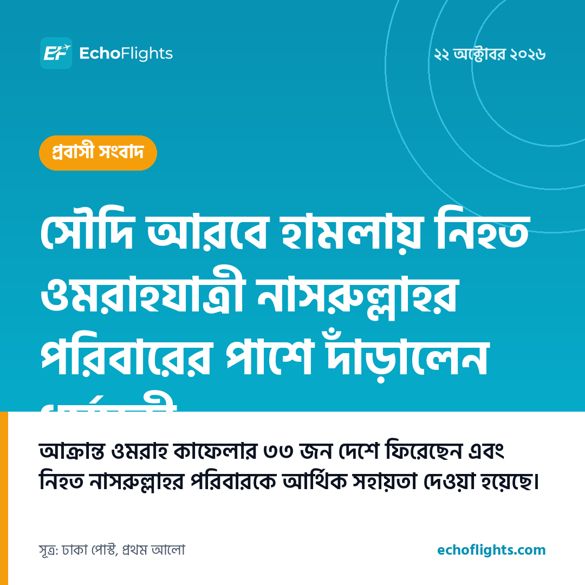

**Facebook caption**

```
সৌদি আরবের রিয়াদে বিমানবন্দরে হামলায় নিহত বাংলাদেশি ওমরাহযাত্রী মুফতি মো. নাসরুল্লাহ বদরপুরির পরিবারের দায়িত্ব নিয়েছেন ধর্ম বিষয়ক মন্ত্রী কাজী শাহ মোফাজ্জাল হোসাইন (কায়কোবাদ)।

গত ১০ অক্টোবর রিয়াদের আন্তর্জাতিক বিমানবন্দরে ৪৫ সদস্যের এক ওমরাহ কাফেলা হামলার শিকার হয়। এতে দলনেতা মুফতি নাসরুল্লাহ (৪৫) নিহত এবং বেশ কয়েকজন আহত হন। ধর্মমন্ত্রীর উদ্যোগে ক্ষতিগ্রস্ত পরিবারটিকে ৫০ হাজার টাকা আর্থিক সহায়তা দেওয়া হয়েছে। পাশাপাশি দাফন, আবাসন ও সন্তানদের শিক্ষার দায়িত্ব নেওয়ার আশ্বাস দেওয়া হয়েছে। কাফেলার ৩৩ জন সদস্য মঙ্গলবার রাতে দেশে ফিরে এসেছেন।

সূত্র: ঢাকা পোস্ট ও প্রথম আলো

#EchoFlights #Riyadh #SaudiArabia #Bangladesh #OmrahPilgrim #ExpatNews
```

**Blog:** [সৌদি আরবে হামলায় নিহত ওমরাহযাত্রীর পরিবারের পাশে ধর্মমন্ত্রী, দেশে ফিরেছেন ৩৩ যাত্রী](2026-10-22/6639318cda/blog.md) · slug `minister-supports-family-of-omrah-pilgrim-killed-in-riyadh`

**Sources:** [ঢাকা পোস্ট](https://www.dhakapost.com/national/492087) · [প্রথম আলো](https://www.prothomalo.com/bangladesh/rfkk5ieb3r)

_Rewritten once after review (1 issues in first draft)._

---

## সৌদি আরবের রিয়াদসহ বিভিন্ন রুটে বিমানের ফ্লাইট চালুর সিদ্ধান্ত

✅ approved · 22 Oct 11:34 Dhaka · score 10 · flight_disruption · sources: BD24Live, Bangladesh Diplomat

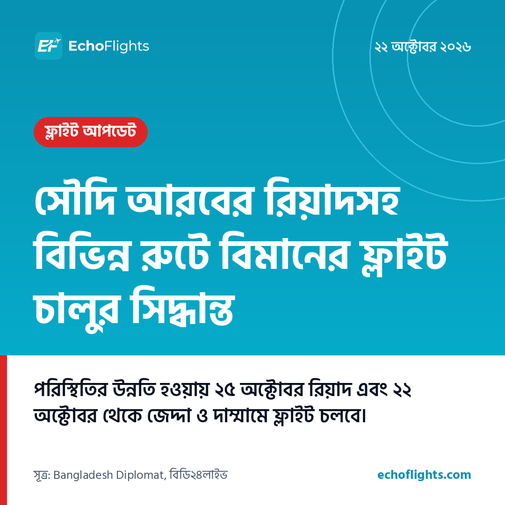

**Facebook caption**

```
✈️ সৌদি আরবের বিমানবন্দরগুলোর নিরাপত্তা পরিস্থিতির উন্নতি হওয়ায় দেশটির বিভিন্ন রুটে পুনরায় ফ্লাইট পরিচালনা শুরু করেছে বিমান বাংলাদেশ এয়ারলাইনস।

আগামী ২৫ অক্টোবর রাত ১টা ২৫ মিনিটে ঢাকা থেকে রিয়াদের উদ্দেশে একটি ফ্লাইট ছেড়ে যাবে। এছাড়া ২২ অক্টোবর সকাল ৮টা থেকে ঢাকা-দাম্মাম রুটে বোয়িং ৭৭৭ উড়োজাহাজ দিয়ে ফ্লাইট শুরু হয়েছে, যা ২৬ অক্টোবর পর্যন্ত প্রতিদিন চলবে। ২২ অক্টোবর জেদ্দা রুটে দুটি এবং ২৩, ২৪ ও ২৫ অক্টোবর প্রতিদিন সন্ধ্যা ৭টা ২০ মিনিটে একটি করে ফ্লাইট ছেড়ে যাবে। মদিনা রুটে আগের মতোই নিয়মিত ফ্লাইট চলছে।

যাত্রীদের ভ্রমণের পূর্বে এয়ারলাইন্সের মাধ্যমে নিজ নিজ ফ্লাইটের সর্বশেষ সময়সূচি নিশ্চিত হতে বলা হয়েছে।

সূত্র: বাংলাদেশ ডিপ্লোম্যাট ও বিডি২৪লাইভ

#BimanBangladesh #SaudiArabia #FlightUpdate #Riyadh #EchoFlights
```

**Blog:** [সৌদি আরবে ফের চালু হচ্ছে বিমানের ফ্লাইট: জেনে নিন রিয়াদ, জেদ্দা ও দাম্মামের সময়সূচি](2026-10-22/e2b4e2fa9a/blog.md) · slug `biman-resumes-flights-to-saudi-arabia-riyadh`

**Sources:** [Bangladesh Diplomat](https://bangladeshdiplomat.com/43768/latest/raw38091/) · [বিডি২৪লাইভ](https://www.bd24live.com/bangla/810385)

---

## সৌদি আরবে বাংলাদেশি অভিবাসী কর্মীদের সুরক্ষার বিষয়টি নতুন করে আলোচনায়

❌ rejected · 22 Oct 10:05 Dhaka · score 10 · expat_alert · sources: BBC Bangla, Prothom Alo

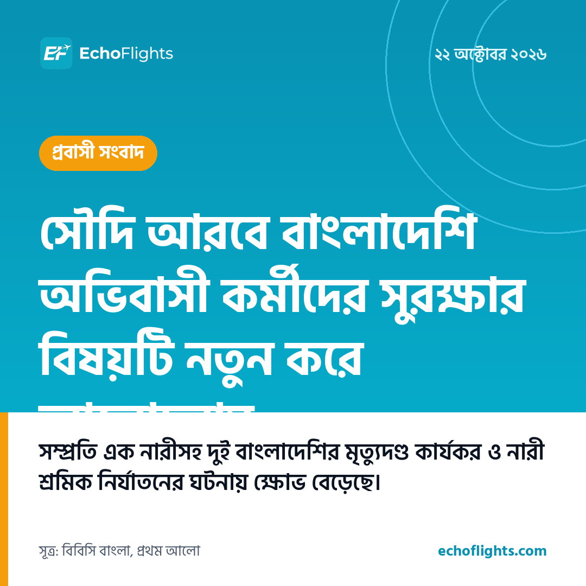

**Facebook caption**

```
সৌদি আরবে বাংলাদেশি অভিবাসী কর্মীদের সুরক্ষার বিষয়টি নতুন করে আলোচনায় এসেছে। সম্প্রতি এক নারীসহ দুই বাংলাদেশি নাগরিকের মৃত্যুদণ্ড কার্যকর করা এবং নির্যাতনের শিকার হয়ে নারী শ্রমিকদের দেশে ফেরার ঘটনায় উদ্বেগ প্রকাশ করছেন সংশ্লিষ্টরা।

সরকারি হিসাব মতে, ২০২৪ সালের জানুয়ারি থেকে চলতি বছরের অক্টোবরের মাঝামাঝি পর্যন্ত বিদেশে যাওয়া ১ লাখ ৭২ হাজারের বেশি নারী শ্রমিকের মধ্যে ১ লাখ ২০ হাজারই গেছেন সৌদি আরবে। চলতি বছরের সেপ্টেম্বর পর্যন্ত ফিরে আসা দেড় হাজারের বেশি নারী কর্মীর মধ্যে প্রায় এক হাজারই ফিরেছেন সৌদি থেকে। আকস্মিক সংকট ও নিরাপত্তাহীনতায় প্রবাসীদের সুরক্ষায় কার্যকর রাষ্ট্রীয় পদক্ষেপ ও ডিজিটাল ডেটাবেইস তৈরির তাগিদ দিচ্ছেন সংশ্লিষ্টরা।

সৌদি আরব ভ্রমণ ও কাজের বিষয়ে কোনো প্রয়োজনে দূতাবাস বা সরকারি চ্যানেলে যোগাযোগের পরামর্শ দেওয়া হচ্ছে।

সূত্র: বিবিসি বাংলা, প্রথম আলো

#EchoFlights #SaudiArabia #ExpatNews #BangladeshiWorkers #MigrantWorkers
```

**Blog:** [সৌদি আরবে বাংলাদেশি অভিবাসী ও নারী শ্রমিকদের সুরক্ষা নিশ্চিতের তাগিদ](2026-10-22/48cd1c7e08/blog.md) · slug `bangladeshi-workers-safety-risks-saudi-arabia`

**Sources:** [বিবিসি বাংলা](https://www.bbc.com/bengali/articles/cje36xln66xko?at_medium=RSS&at_campaign=rss) · [প্রথম আলো](https://www.prothomalo.com/opinion/column/6irjann7r1)

**Review notes (last attempt):**

- caption: The draft mixes two different stories. It links the execution of citizens and torture of female workers (from Source 1) to the demand for a 'digital database' (from Source 2). However, Source 2 suggests the digital database specifically to manage logistical and security crises like flight cancellations and airport attacks, not as a solution for legal executions or workplace torture.

_Rewritten once after review (1 issues in first draft)._

---

## চাকরির প্রলোভনে রাশিয়ায় গিয়ে যুদ্ধে জড়িয়ে পড়া বাংলাদেশিদের প্রাণহানি

⏳ will retry · 22 Oct 09:34 Dhaka · score 10 · expat_alert · sources: BBC Bangla, Prothom Alo

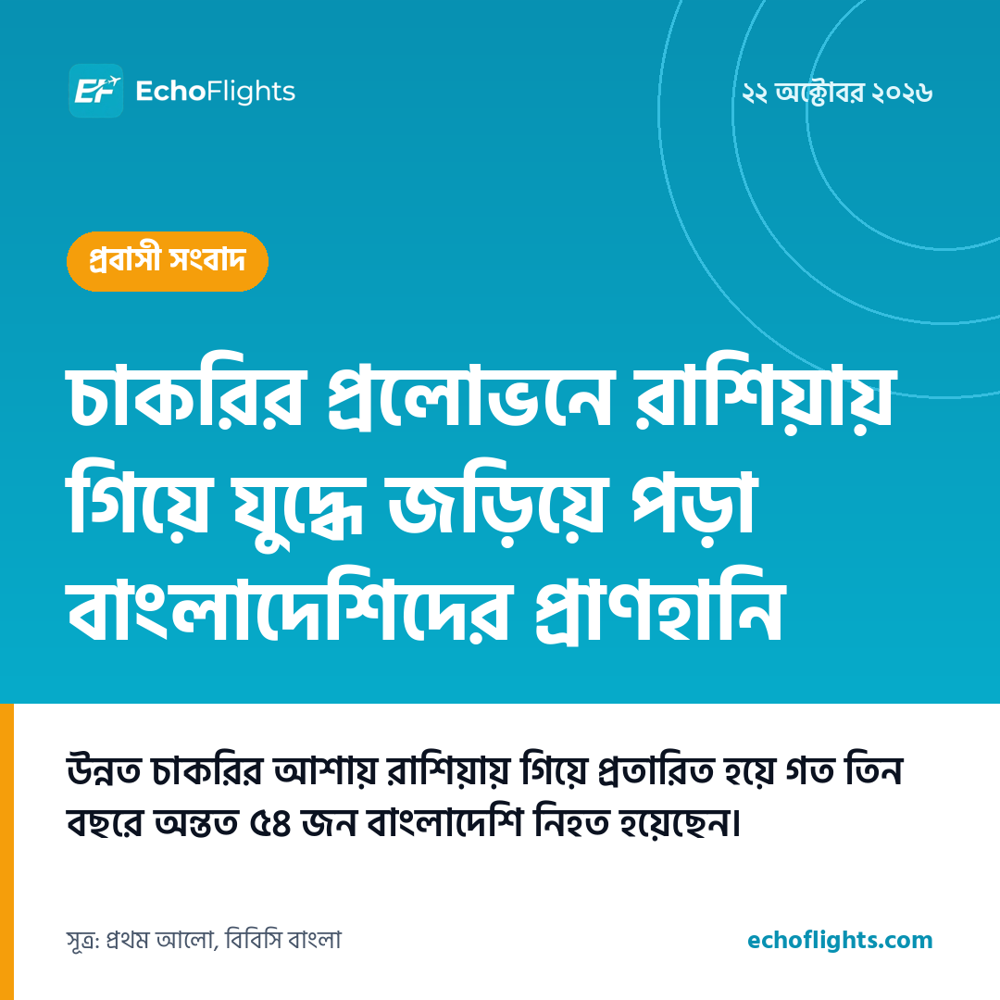

**Facebook caption**

```
উচ্চ বেতনে চাকরির প্রলোভনে পড়ে রাশিয়ায় গিয়ে প্রতারিত হচ্ছেন অনেক বাংলাদেশি তরুণ। দেশটিতে গিয়ে যুদ্ধের ক্যাম্পে ঠাঁই হওয়া এবং রাশিয়া-ইউক্রেন যুদ্ধে জড়িয়ে পড়ে গত তিন বছরে অন্তত ৫৪ জন বাংলাদেশির মৃত্যুর খবর পাওয়া গেছে।

বিভিন্ন রিক্রুটিং এজেন্সির মাধ্যমে রাশিয়ায় যাওয়ার পর ২১ দিনের প্রশিক্ষণ শেষে তাদের যুদ্ধক্ষেত্রে পাঠানো হয়। বর্তমান সরকার রাশিয়ায় যাওয়ার ক্ষেত্রে কড়াকড়ি আরোপ করেছে এবং দূতাবাস থেকেও যাচাই-বাছাই ছাড়া কর্মী না পাঠানোর তাগিদ দেওয়া হয়েছে।

সূত্র: প্রথম আলো, বিবিসি বাংলা
#EchoFlights #Russia #BangladeshiWorkers #ExpatNews #TravelAlert
```

**Blog:** [চাকরির প্রলোভনে রাশিয়ায় গিয়ে যুদ্ধে জড়িয়ে পড়ার ঘটনা, ৩ বছরে ৫৪ বাংলাদেশির মৃত্যু](2026-10-22/26d03905ff/blog.md) · slug `bangladeshi-workers-lured-to-russia-war-deaths`

**Sources:** [প্রথম আলো](https://www.prothomalo.com/bangladesh/mkf2is07uv) · [বিবিসি বাংলা](https://www.bbc.com/bengali/articles/cjy5606yg95do?at_medium=RSS&at_campaign=rss)

**Review notes (last attempt):**

- category: unknown category
- -: rewrite could not run: gemini-3.6-flash: HTTP 503 after 2s b'{\n  "error": {\n    "code": 503,\n    "message": "This model is currently experiencing high demand. Spikes in d

---

## সৌদি আরবে বাংলাদেশি নারী সুইটি আক্তারের মৃত্যুদণ্ড কার্যকর নিয়ে উদ্বেগ

⏳ will retry · 22 Oct 08:02 Dhaka · score 10 · expat_alert · sources: BBC Bangla, BD24Live, Prothom Alo

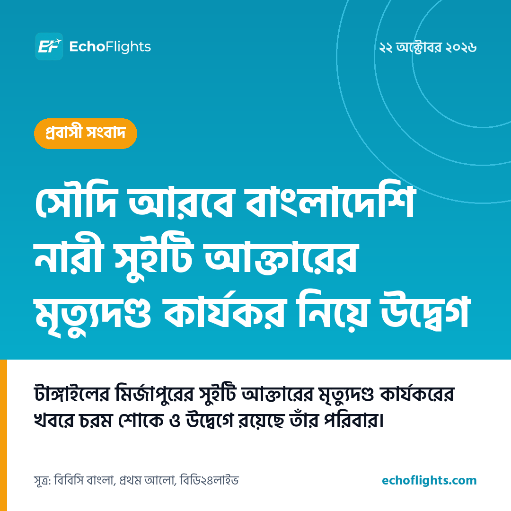

**Facebook caption**

```
সৌদি আরবে টাঙ্গাইলের মির্জাপুরের বাসিন্দা সুইটি আক্তার নামের এক বাংলাদেশি নারীর মৃত্যুদণ্ড কার্যকরের খবর পাওয়া গেছে।

প্রবাসী কল্যাণ মন্ত্রণালয় সূত্রে জানা গেছে, ২০২৩ সালে সরকারি নিয়ম মেনে পরিচ্ছন্নতাকর্মী হিসেবে সৌদি আরবে যান সুইটি। সেখানে যাওয়ার প্রায় ৬ মাসের মাথায় তিনি গ্রেপ্তার হন। পরিবার জানায়, কারাগার থেকেও তিনি নিয়মিত পরিবারকে ফোন দিতেন। গত ১৪ অক্টোবর তাঁর মৃত্যুদণ্ড কার্যকরের খবর ছড়িয়ে পড়লে পরিবারে শোক নেমে আসে। তবে স্থানীয় প্রশাসন জানায়, বিষয়টিতে সরকারি নিশ্চিত হওয়ার চেষ্টা চলছে।

সূত্র: বিবিসি বাংলা, প্রথম আলো ও বিডি২৪লাইভ

#EchoFlights #SaudiArabia #ExpatNews #Tangail #Bangladesh #BangladeshiExpat
```

**Blog:** [সৌদি আরবে বাংলাদেশি নারী সুইটি আক্তারের মৃত্যুদণ্ড কার্যকরের খবরে পরিবারে শোক](2026-10-22/6afcf94b8e/blog.md) · slug `saudi-arabia-bangladeshi-woman-sweety-execution-news`

**Sources:** [বিবিসি বাংলা](https://www.bbc.com/bengali/articles/c9zrdpk0462zo?at_medium=RSS&at_campaign=rss) · [প্রথম আলো](https://www.prothomalo.com/bangladesh/district/saudite-suittir-mrtyudnndd-mirjaapure-shok) · [বিডি২৪লাইভ](https://www.bd24live.com/bangla/810298)

**Review notes (last attempt):**

- caption: number 24 does not appear in any source
- caption: number 6 does not appear in any source
- blog_body: number 24 does not appear in any source
- blog_body: number 6 does not appear in any source
- -: rewrite could not run: gemini-3.8-flash: HTTP 503 after 1s b'{\n  "error": {\n    "code": 503,\n    "message": "This model is currently experiencing high demand. Spikes in d

---

## সৌদিতে ভিক্ষা করার অভিযোগে বাংলাদেশিসহ চারজন গ্রেপ্তার

✅ approved · 22 Oct 05:31 Dhaka · score 9 · expat_alert · sources: BD24Live, Dhaka Post

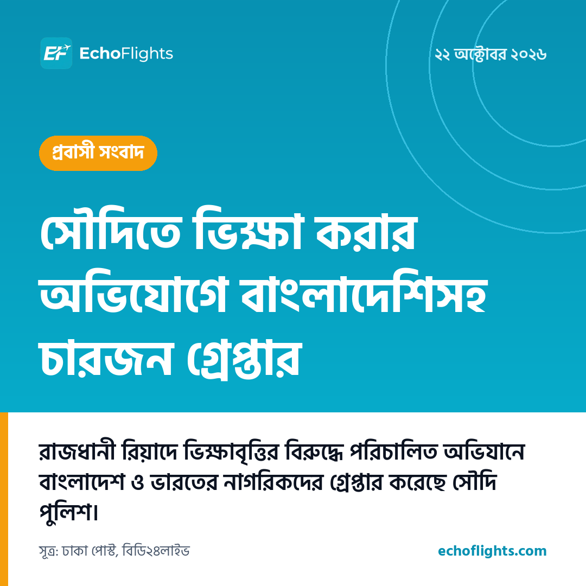

**Facebook caption**

```
সৌদি আরবের রাজধানী রিয়াদে ভিক্ষা করার অভিযোগে বাংলাদেশ ও ভারতের চার নাগরিককে গ্রেপ্তার করেছে দেশটির পুলিশ।

সৌদি স্বরাষ্ট্র মন্ত্রণালয়ের ভিক্ষাবৃত্তি নিয়ন্ত্রণ কার্যক্রমের অংশ হিসেবে রিয়াদ অঞ্চল থেকে তাদের আটক করা হয়। আটক ব্যক্তিদের বিরুদ্ধে দেশটির আইন অনুযায়ী ব্যবস্থা নেওয়া হচ্ছে। একই সঙ্গে দান-খয়রাত কেবল সরকার অনুমোদিত মাধ্যমে প্রদানের জন্য সর্বসাধারণের প্রতি আহ্বান জানিয়েছে সৌদি কর্তৃপক্ষ।

সূত্র: ঢাকা পোস্ট
#SaudiArabia #Riyadh #ExpatNews #SaudiPolice #EchoFlights
```

**Blog:** [সৌদিতে ভিক্ষাবৃত্তির অভিযোগে বাংলাদেশিসহ চারজন গ্রেপ্তার](2026-10-22/be2de95405/blog.md) · slug `bangladeshis-arrested-begging-saudi-arabia-riyadh`

**Sources:** [ঢাকা পোস্ট](https://www.dhakapost.com/international/491906) · [বিডি২৪লাইভ](https://www.bd24live.com/bangla/810289)

_Rewritten once after review (2 issues in first draft)._

---

## কাবার ভাইরাল ভিডিওটি মৃত্যুদণ্ড কার্যকর হওয়া বাংলাদেশিদের নয়

❌ rejected · 22 Oct 04:01 Dhaka · score 10 · expat_alert · sources: BD24Live, Dhaka Post

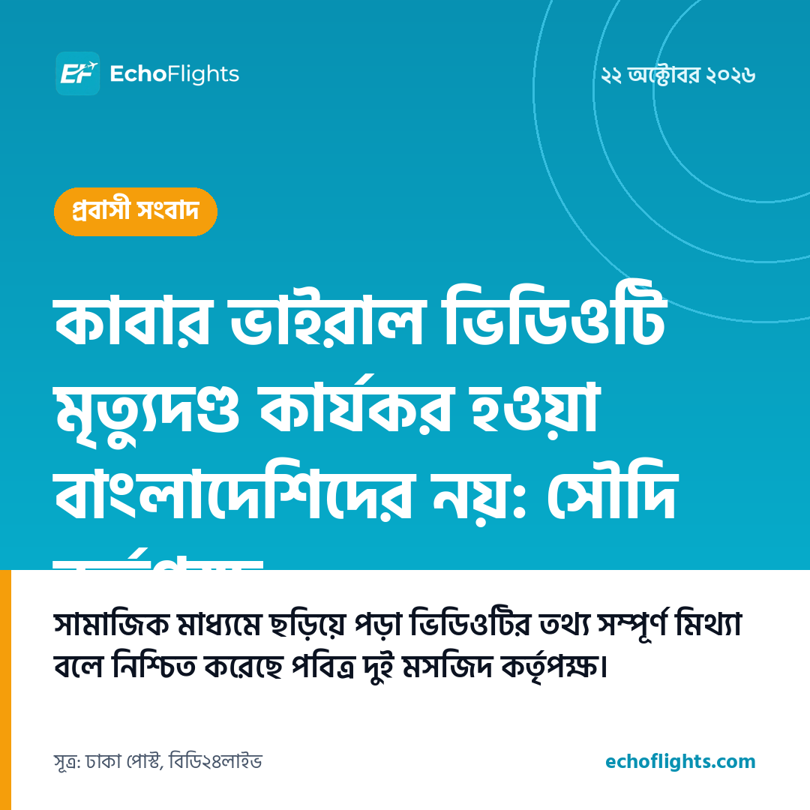

**Facebook caption**

```
সামাজিকমাধ্যমে কাবার কালো পাথরের কাছে ছড়িয়ে পড়া ভাইরাল ভিডিওটি মৃত্যুদণ্ড কার্যকর হওয়া দুই বাংলাদেশির নয় বলে নিশ্চিত করেছে সৌদির দুই পবিত্র মসজিদ কর্তৃপক্ষ।

কর্তৃপক্ষ তাদের অফিশিয়াল এক্স অ্যাকাউন্টে জানায়, ভিডিওটি যে দাবি নিয়ে প্রচার করা হচ্ছে তা সম্পূর্ণ মিথ্যা এবং এটি মৃত্যুদণ্ড দেওয়ার কোনো প্রমাণ নয়। গত ১৪ অক্টোবর পবিত্র মক্কার একটি মসজিদে অনৈতিক কাজের অভিযোগে নজরুল ইসলাম ও সিঁথি আক্তার নামের দুই বাংলাদেশির মৃত্যুদণ্ড কার্যকর করে সৌদি আরব। তবে ওই ভাইরাল ভিডিওর সঙ্গে তাদের কোনো সম্পর্ক নেই।

সূত্র: ঢাকা পোস্ট ও বিডি২৪লাইভ
#SaudiArabia #ExpatNews #FactCheck #BangladeshisAbroad #EchoFlights
```

**Blog:** [কাবার ভাইরাল ভিডিও মৃত্যুদণ্ড কার্যকর হওয়া বাংলাদেশিদের নয়: সৌদি কর্তৃপক্ষ](2026-10-22/5292c158d6/blog.md) · slug `viral-kaaba-video-not-executed-bangladeshis`

**Sources:** [ঢাকা পোস্ট](https://www.dhakapost.com/international/491864) · [বিডি২৪লাইভ](https://www.bd24live.com/bangla/810260)

**Review notes (last attempt):**

- caption: number 24 does not appear in any source
- blog_body: number 24 does not appear in any source

_Rewritten once after review (5 issues in first draft)._

---

## সৌদিতে মৃত্যুদণ্ডপ্রাপ্ত বাংলাদেশিদের নিয়ে ভাইরাল ভিডিওটি বিভ্রান্তিকর

⏳ will retry · 21 Oct 16:15 Dhaka · score 10 · expat_alert · sources: BD24Live, Dhaka Post, Khaleej Times, Prothom Alo

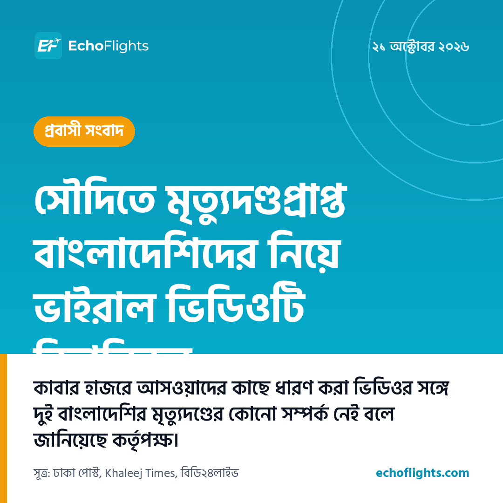

**Facebook caption**

```
সৌদি আরবে মৃত্যুদণ্ড কার্যকর হওয়া দুই বাংলাদেশির নামে সামাজিক যোগাযোগমাধ্যমে ছড়িয়ে পড়া ভিডিওটি বিভ্রান্তিকর ও মিথ্যা বলে জানিয়েছে সৌদির দুই পবিত্র মসজিদ কর্তৃপক্ষ।

মক্কার একটি মসজিদে অনৈতিক কাজের অভিযোগে গত ১৪ অক্টোবর নজরুল ইসলাম ও সিঁথি আক্তার নামে দুই বাংলাদেশির মৃত্যুদণ্ড কার্যকর করে সৌদি কর্তৃপক্ষ। এর পরপরই কাবার হাজরে আসওয়াদের কাছে এক ব্যক্তির এক নারীকে ধাক্কা দেওয়ার দৃশ্য ভাইরাল করে সেটিকে মৃত্যুদণ্ডপ্রাপ্তদের ভিডিও বলে দাবি করা হচ্ছিল। তবে দুই পবিত্র মসজিদ কর্তৃপক্ষ এক বার্তায় জানিয়েছে, এ দাবির কোনো সত্যতা নেই এবং এটি তাদের দণ্ডের প্রমাণ নয়।

সূত্র: ঢাকা পোস্ট, Khaleej Times, বিডি২৪লাইভ
#SaudiArabia #ExpatNews #EchoFlights #BangladeshisAbroad #FactCheck
```

**Blog:** [সৌদিতে দুই বাংলাদেশির মৃত্যুদণ্ড ও কাবার ভাইরাল ভিডিও: যা জানাল কর্তৃপক্ষ](2026-10-21/4cd96fb3e3/blog.md) · slug `saudi-viral-video-bangladeshi-execution-clarification`

**Sources:** [ঢাকা পোস্ট](https://www.dhakapost.com/international/491864) · [Khaleej Times](https://www.khaleejtimes.com/world/gulf/fact-check-viral-video-execution-2-bangladeshis-saudi-arabia-makkah-misleading) · [বিডি২৪লাইভ](https://www.bd24live.com/bangla/810260)

**Review notes (last attempt):**

- caption: number 24 does not appear in any source
- blog_body: number 24 does not appear in any source
- caption: Unnatural phrasing: 'ভাইরাল করে সেটিকে' is awkward in standard journalistic Bangla.
- blog_body: Stray/unrelated hashtag or section title concept: '#EchoFlights' inside the caption hashtags is completely unrelated to the news story about Saudi executions.
- -: rewrite could not run: gemma-4-31b-it: HTTP 500 after 1s b'{\n  "error": {\n    "code": 500,\n    "message": "Internal error encountered.",\n    "status": "INTERNAL"\n  }\n}

---

## রিয়াদে হামলায় নিহত বাংলাদেশি কর্মী শাহেদের মরদেহ দেশে আসছে শুক্রবার

✅ approved · 21 Oct 13:35 Dhaka · score 10 · expat_alert · sources: BD24Live, Dhaka Post

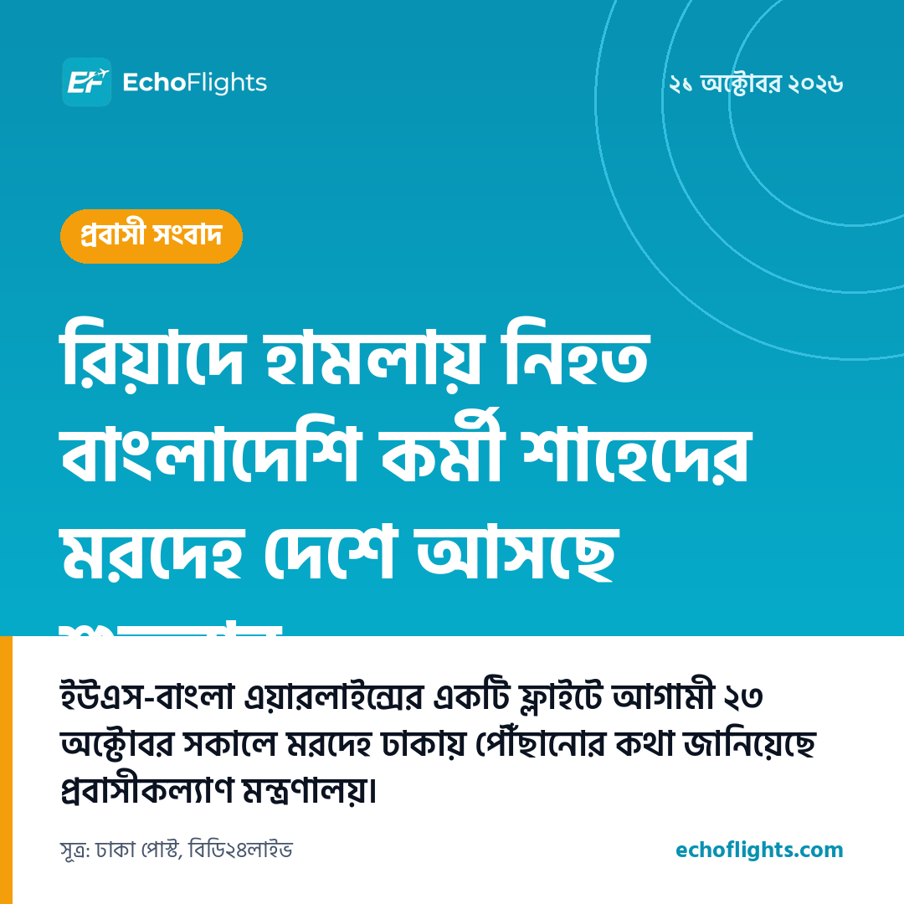

**Facebook caption**

```
সৌদি আরবের রিয়াদে হামলায় নিহত বাংলাদেশি কর্মী মো. শাহেদ আহম্মেদের মরদেহ আগামী ২৩ অক্টোবর (শুক্রবার) সকালে দেশে পৌঁছাবে। প্রবাসীকল্যাণ ও বৈদেশিক কর্মসংস্থান মন্ত্রণালয় এ তথ্য জানিয়েছে।

মন্ত্রণালয় জানায়, গত ১০ অক্টোবর রিয়াদের কিং খালেদ আন্তর্জাতিক বিমানবন্দরে সংঘটিত হামলায় বগুড়ার সন্তান শাহেদ নিহত হন। আগামী ২২ অক্টোবর রিয়াদ সময় রাত ১১টা ১০ মিনিটে ইউএস-বাংলা এয়ারলাইন্সের ফ্লাইট BS 362 যোগে জেদ্দা থেকে তাঁর মরদেহ রওনা হয়ে ২৩ অক্টোবর সকাল ৮টা ৩৫ মিনিটে ঢাকার হযরত শাহজালাল আন্তর্জাতিক বিমানবন্দরে পৌঁছাবে।

নিহতের নিয়োগকারী প্রতিষ্ঠান থেকে বকেয়া পাওনা বাবদ প্রায় ৯ লাখ টাকা (২৭ হাজার ৩৯৫.৬২ সৌদি রিয়াল) দূতাবাসের অ্যাকাউন্টে জমা হয়েছে, যা দ্রুতই পরিবারের কাছে হস্তান্তর করা হবে।

সূত্র: ঢাকা পোস্ট, বিডি টুয়েন্টিফোর লাইভ
#SaudiArabia #Riyadh #ExpatNews #Bangladesh #EchoFlights
```

**Blog:** [রিয়াদে বিমানবন্দরে হামলায় নিহত বাংলাদেশি শাহেদের মরদেহ দেশে আসছে ২৩ অক্টোবর](2026-10-21/590b31f4e1/blog.md) · slug `riyadh-airport-attack-bangladeshi-body-return`

**Sources:** [ঢাকা পোস্ট](https://www.dhakapost.com/national/491912) · [বিডি২৪লাইভ](https://www.bd24live.com/bangla/810303)

_Rewritten once after review (2 issues in first draft)._

---

## সৌদি আরবে দুই বাংলাদেশির মৃত্যুদণ্ড: বিচারিক রায়ের কপি চেয়েছে ঢাকা

✅ approved · 21 Oct 13:35 Dhaka · score 10 · expat_alert · sources: BBC Bangla, BD24Live, Bangladesh Diplomat, Bangladesh Journal, Dhaka Post, Khaleej Times, Prothom Alo, The Straits Times

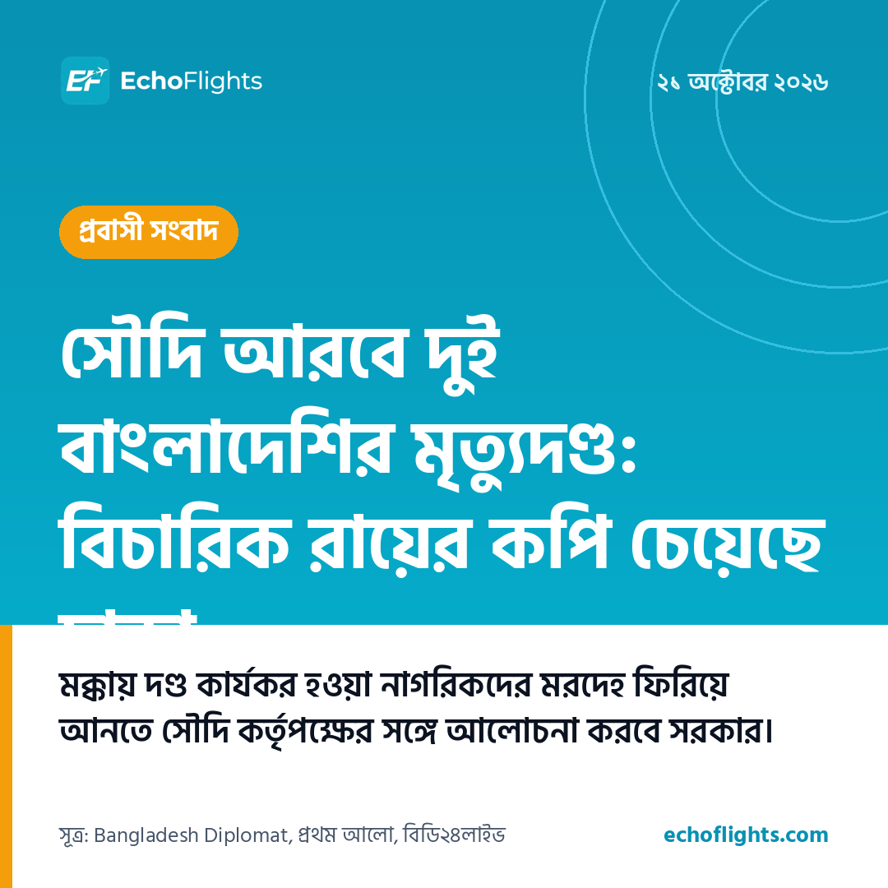

**Facebook caption**

```
সৌদি আরবের মক্কায় দুই বাংলাদেশি নাগরিকের মৃত্যুদণ্ড কার্যকরের ঘটনায় দেশটির কাছে বিচারিক রায়ের অনুলিপি চেয়েছে বাংলাদেশ সরকার। রায়ের কপি হাতে পাওয়ার পর দুই দেশের আলোচনার মাধ্যমে মরদেহ ফিরিয়ে আনার প্রক্রিয়া শুরু হবে বলে জানিয়েছে পররাষ্ট্র মন্ত্রণালয়।

পররাষ্ট্র প্রতিমন্ত্রী শামা ওবায়েদ জানান, ২০২৩ সালে সৌদি পুলিশের হাতে আটক হওয়া এই ব্যক্তিদের ব্যাপারে আগে পরিবার সরকারের সঙ্গে যোগাযোগ করেনি। এর আগে পররাষ্ট্র প্রতিমন্ত্রী হুমায়ুন কবির জানান, এ বিষয়ে দুই দেশের মধ্যে তথ্য আদান-প্রদানে ঘাটতি ছিল। দণ্ডপ্রাপ্তদের একজন ব্রাহ্মণবাড়িয়ার নজরুল ইসলাম, যিনি মক্কার মসজিদুল হারামে পরিচ্ছন্নতাকর্মী ছিলেন।

সূত্র: বাংলাদেশ ডিপ্লোম্যাট, প্রথম আলো ও বিডি টুয়েন্টিফোর লাইভ
#EchoFlights #SaudiArabia #ExpatNews #Bangladesh
```

**Blog:** [সৌদি আরবে দুই বাংলাদেশির মৃত্যুদণ্ড: রায়ের কপি পাওয়ার পর মরদেহ ফেরতের প্রক্রিয়া](2026-10-21/2467b5cc73/blog.md) · slug `saudi-arabia-bangladeshi-execution-verdict-copy`

**Sources:** [Bangladesh Diplomat](https://bangladeshdiplomat.com/43343/latest/raw37001/) · [প্রথম আলো](https://www.prothomalo.com/opinion/column/60k5szs5a2) · [বিডি২৪লাইভ](https://www.bd24live.com/bangla/810193)

_Rewritten once after review (2 issues in first draft)._

---

## কম্বোডিয়ায় আটক ৩০ বাংলাদেশি কর্মী মঙ্গলবার দেশে ফিরছেন

✅ approved · 20 Oct 16:05 Dhaka · score 10 · expat_alert · sources: Bangladesh Journal, Prothom Alo

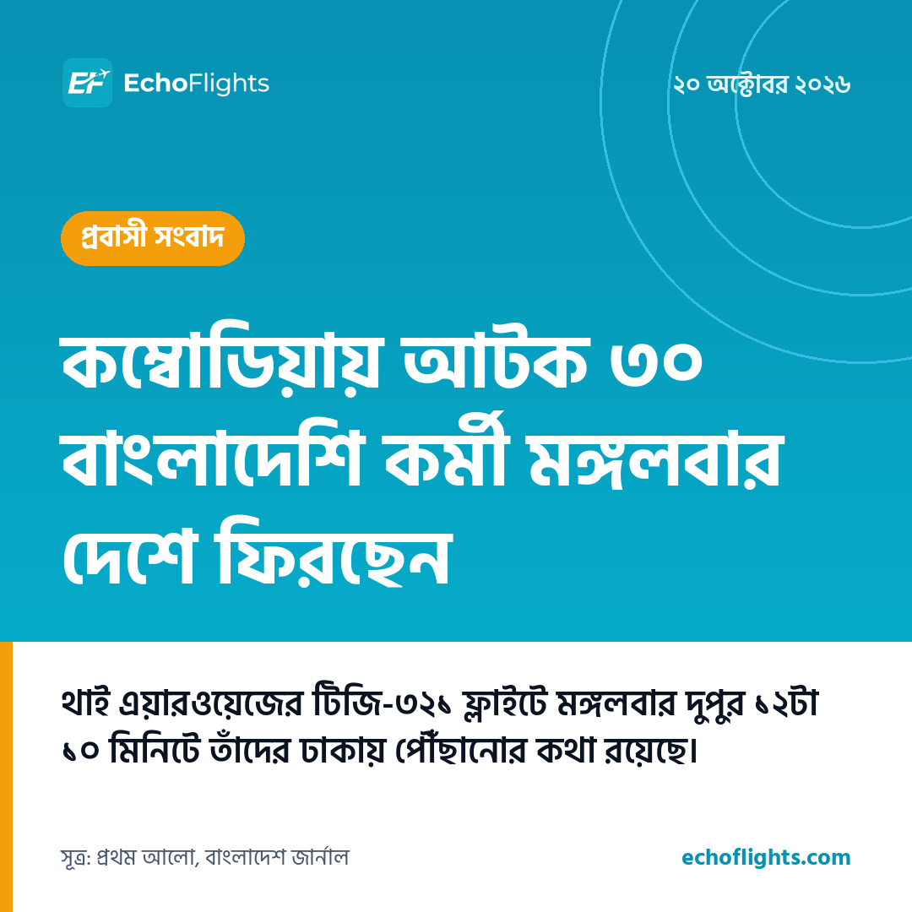

**Facebook caption**

```
কম্বোডিয়ার ইমিগ্রেশন ডিটেনশন সেন্টারে আটক থাকার পর অবশেষে দেশে ফিরছেন ৩০ জন বাংলাদেশি কর্মী। মঙ্গলবার থাই এয়ারওয়েজের টিজি-৩২১ ফ্লাইটে দুপুর ১২টা ১০ মিনিটে তাঁদের ঢাকার হযরত শাহজালাল আন্তর্জাতিক বিমানবন্দরে পৌঁছানোর কথা রয়েছে।

দালাল চক্রের প্রলোভনে পড়ে কম্বোডিয়ায় গিয়ে সাইবার স্ক্যামিং সেন্টারে নানা নির্যাতনের শিকার হন তাঁরা। পরবর্তীতে গত ৩ সেপ্টেম্বর দেশে ফেরার উদ্দেশ্যে রাজধানী নমপেনের বিমানবন্দরে গেলে অবৈধ অবস্থানের কারণে তাঁদের আটক করে দেশটির ইমিগ্রেশন পুলিশ। প্রবাসী কল্যাণ মন্ত্রণালয় ও অনির্বাণ সারভাইভার ভয়েস ফাউন্ডেশনের যৌথ উদ্যোগে তাঁদের মুক্তির ব্যবস্থা করা হয়।

সূত্র: প্রথম আলো ও বাংলাদেশ জার্নাল

#EchoFlights #Cambodia #BangladeshiExpats #ExpatNews #DhakaAirport
```

**Blog:** [কম্বোডিয়ার বন্দিশালা থেকে দেশে ফিরছেন ৩০ বাংলাদেশি কর্মী](2026-10-20/600668bd9c/blog.md) · slug `stranded-bangladeshis-returning-from-cambodia-detention`

**Sources:** [প্রথম আলো](https://www.prothomalo.com/bangladesh/68ooqvddx5) · [বাংলাদেশ জার্নাল](https://www.bd-journal.com/bangladesh/314446/বন্দিশালা-থেকে-মুক্তির-পর-কম্বোডিয়া-থেকে-মঙ্গলবার-দেশে-ফিরবেন-৩০-বাংলাদেশি) (feed summary only)

---

## সৌদিগামী ১২৬ ফ্লাইট বিঘ্নিত, ভোগান্তিতে ১৯ হাজারের বেশি যাত্রী

❌ rejected · 20 Oct 16:05 Dhaka · score 10 · flight_disruption · sources: BD24Live, Doha News, Khaleej Times, Prothom Alo

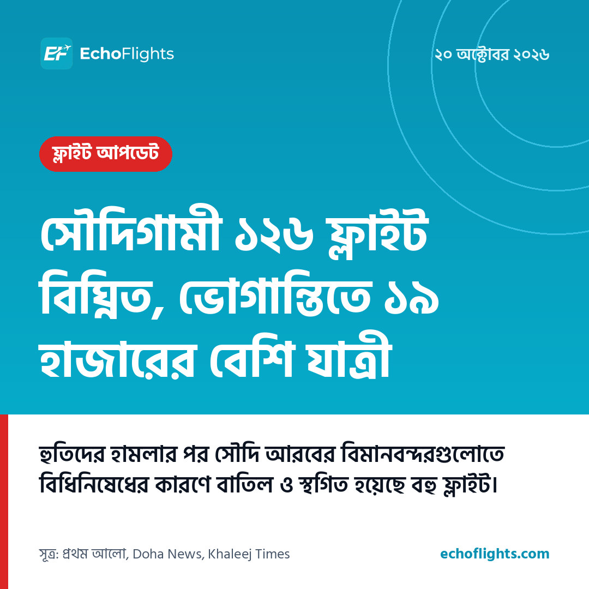

**Facebook caption**

```
সৌদি আরবে হুতিদের হামলার জেরে বিমানবন্দরগুলোতে বিধিনিষেধ জারি করায় গত ১০ দিনে বাংলাদেশের ১২৬টি ফ্লাইট বিঘ্নিত হয়েছে। এর ফলে ভোগান্তিতে পড়েছেন ১৯ হাজার ৩৭৭ জন যাত্রী।

বেসামরিক বিমান চলাচল কর্তৃপক্ষের (বেবিচক) তথ্য অনুযায়ী, বিঘ্নিত ফ্লাইটের মধ্যে ৫৯টি সরাসরি এবং ৬৭টি ট্রানজিট ফ্লাইট। বিমান বাংলাদেশ এয়ারলাইনস, ইউএস-বাংলাসহ বিভিন্ন আন্তর্জাতিক এয়ারলাইনসের রিয়াদ ও দাম্মাম ফ্লাইট স্থগিত রয়েছে। যাত্রীদের বিকল্প হিসেবে জেদ্দা ও মদিনা বিমানবন্দর ব্যবহারের কথা বলা হচ্ছে। একই সঙ্গে বহু ওমরাহ যাত্রীও সৌদি আরবে আটকে পড়েছেন।

সূত্র: প্রথম আলো, Doha News, Khaleej Times
#EchoFlights #SaudiArabia #FlightDisruption #Biman #AviationNews
```

**Blog:** [সৌদি আরবে ফ্লাইট চলাচলে অচলাবস্থা: ১০ দিনে ভোগান্তিতে ১৯ হাজারের বেশি যাত্রী](2026-10-20/1f399da475/blog.md) · slug `saudi-arabia-flight-disruptions-houthi-attacks`

**Sources:** [প্রথম আলো](https://www.prothomalo.com/bangladesh/m3ybnd9f2v) · [প্রথম আলো](https://www.prothomalo.com/bangladesh/65onkvc1yi) · [Doha News](https://dohanews.co/u-s-issues-security-alerts-across-the-middle-east-warns-of-flight-disruptions/) · [Khaleej Times](https://www.khaleejtimes.com/business/flydubai-extends-saudi-flight-cancellations-to-october-24)

**Review notes (last attempt):**

- caption: The claim that many Umrah pilgrims are stuck in Saudi Arabia is not mentioned in any of the sources.
- blog_body: The sources mention attacks on Saudi Arabia and its airports generally, but do not specifically name 'King Khalid International Airport' as the target.
- blog_body: The claim that many Umrah pilgrims are stuck in Saudi Arabia is not mentioned in any of the sources.
- -: rewrite could not run: gemini-3.8-flash: HTTP 503 after 1s b'{\n  "error": {\n    "code": 503,\n    "message": "This model is currently experiencing high demand. Spikes in d

---
